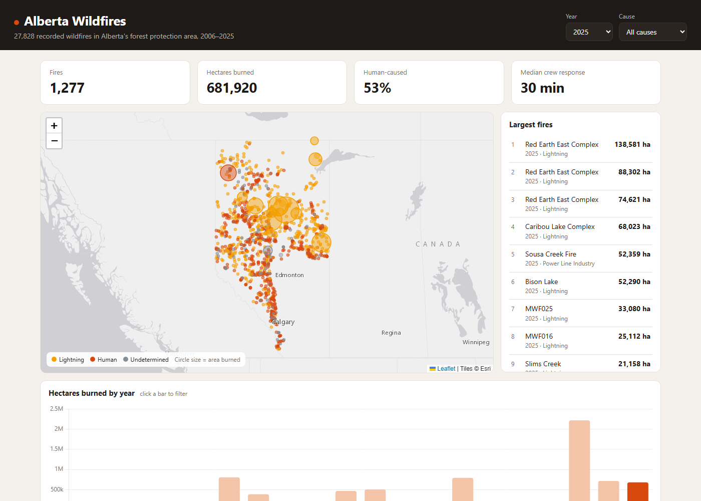

# Alberta Wildfires

An interactive map and dashboard of every wildfire recorded in Alberta's forest protection area since 2006: **27,828 fires**, from the 2016 Fort McMurray fire to the record 2023 season.

**Live site: https://shucab-lane.github.io/alberta-wildfires/**



## Features

- Map of every fire, sized by area burned and colored by cause (lightning or human)
- Filter by year and cause; click a bar in the yearly chart to jump to that season
- Largest fires list: click one to fly to it on the map
- Hectares burned per year, fire season by month, top causes, and median crew response time

## Built with

- **Python + pandas**: downloads the government CSV, cleans it, and calculates response times
- **SQLite + SQL**: stores the cleaned data and builds the yearly and regional summaries
- **JavaScript, HTML, CSS**: the front end, using [Leaflet](https://leafletjs.com/) for the map and [Chart.js](https://www.chartjs.org/) for charts
- **GitHub Actions**: re-runs the data pipeline every week and deploys to GitHub Pages

## Run it locally

```bash
pip install -r requirements.txt
python -m etl.pipeline           # download data, build data/wildfires.db and site/data/*.json
cd site && python -m http.server # open http://localhost:8000
pytest                           # run tests
```

## Data

[Historical wildfire data: 2006 to 2025](https://open.alberta.ca/opendata/wildfire-data), Government of Alberta (Open Government Licence – Alberta).
